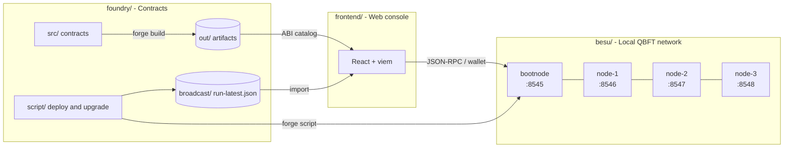
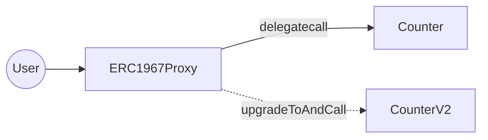
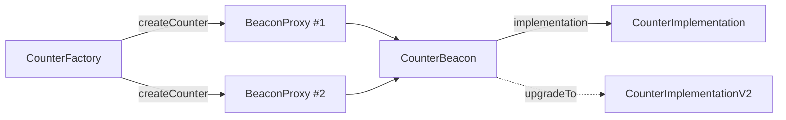

<div align="center">

# Upgradeable Contract Sample

**A complete local setup for building, deploying, upgrading and inspecting upgradeable Solidity contracts on a permissioned Hyperledger Besu network.**


</div>

---

## Overview

This monorepo shows the two most common upgradeability patterns of the OpenZeppelin ecosystem, **UUPS** and **Beacon**, end to end:

1. **`besu/`** starts a local QBFT network of Hyperledger Besu nodes on Docker.
2. **`foundry/`** contains the contracts, deployment and upgrade scripts, and tests.
3. **`frontend/`** is a web console for calling the deployed contracts and checking which implementation each proxy points to.



## Repository structure

```text
.
├── besu/                     # Local Hyperledger Besu QBFT network
│   ├── config/               # Genesis template (chainId 1337, funded dev accounts)
│   ├── startBesu.sh          # Generates keys and genesis, starts the network
│   ├── addNewNode.sh         # Adds validators and runs the QBFT vote
│   └── stopBesu.sh           # Removes containers, Docker network and generated files
├── foundry/                  # Solidity project (Forge)
│   ├── src/
│   │   ├── uups/             # Counter, CounterV2
│   │   └── beacon/           # CounterImplementation(V2), CounterBeacon, CounterFactory
│   ├── script/
│   │   ├── uups/             # Deploy and upgrade scripts for UUPS
│   │   └── beacon/           # Step-by-step scripts for the Beacon flow
│   ├── test/                 # Forge tests
│   ├── broadcast/            # Deployment records used by the frontend
│   ├── lib/                  # Git submodules (forge-std, OpenZeppelin)
│   └── Makefile              # Build, test and deployment shortcuts
└── frontend/                 # React + Vite + Tailwind web console
    ├── src/lib/evm.ts        # viem clients, argument parsing and wallet helpers
    └── vite.config.ts        # Dev-server endpoint that serves ABIs from foundry/out
```

---

## Modules

### 1. `besu/`: local permissioned network

Bash scripts that start a private **Hyperledger Besu** network with **QBFT** consensus, with each node running in its own Docker container.

| Setting | Value |
| --- | --- |
| Chain ID | `1337` |
| Consensus | QBFT, 2-second block period |
| Default size | 4 validators (1 bootnode + 3 nodes) |
| Gas price | `0` (`--min-gas-price=0`) |
| RPC APIs | `ETH`, `NET`, `QBFT` |
| Ports | RPC `8545 + i`, P2P `30303 + i` (node `i`) |
| Docker network | `besu_test_network` |

| Script | Description |
| --- | --- |
| `startBesu.sh [-n N] [-d\|--debug]` | Stops any existing network, downloads Besu `25.4.1` when needed, generates the genesis file and validator keys for `N` nodes (default `4`) and starts the containers. `-d` enables DEBUG logging. |
| `addNewNode.sh [-n N] [-d\|--debug]` | Starts `N` new nodes (default `1`). For each one, every validator votes it in through `qbft_proposeValidatorVote`. The script waits until the validator set changes and then discards the votes. |
| `stopBesu.sh` | Removes all `besu.*` containers, the Docker network and the generated files (`nodes/`, `genesis/`, `.env.network`). |

> [!WARNING]
> The genesis template pre-funds ten accounts with the **publicly known Besu development keys**. Use them only on local networks.

### 2. `foundry/`: upgradeable contracts

A Forge project based on **OpenZeppelin Contracts v5.5.0**, **OpenZeppelin Contracts Upgradeable v5.5.0** and **OpenZeppelin Foundry Upgrades v0.4.0**. All of them are Git submodules under `foundry/lib/`.

The domain logic is the same in both patterns: a `Counter` that stores a `number` and exposes `setNumber` and `retrieve`. Version 2 adds `increment()`. This keeps the focus on how each upgrade works.

#### UUPS pattern (`src/uups/`)

The upgrade logic is in the **implementation**. `Counter` inherits `UUPSUpgradeable`, and `_authorizeUpgrade` is restricted to the owner.



| Contract | Description |
| --- | --- |
| `Counter` | `Initializable` + `OwnableUpgradeable` + `UUPSUpgradeable`. Its constructor calls `_disableInitializers()`. |
| `CounterV2` | Extends `Counter` and adds `increment()`. Annotated with `@custom:oz-upgrades-from Counter` for storage-layout validation. |

| Script | Description |
| --- | --- |
| `script/uups/Counter.s.sol` | Deploys the implementation and the proxy, and calls `initialize`, through `Upgrades.deployUUPSProxy`. The plugin validates the contract first. |
| `script/uups/CounterExpl.s.sol` | Does the same deployment by hand (`new Counter()` + `new ERC1967Proxy(...)`), to show what the plugin does internally. |
| `script/uups/CounterV2.s.sol` | Upgrades the proxy in `PROXY_ADDRESS` to `CounterV2` through `Upgrades.upgradeProxy`. |

#### Beacon pattern (`src/beacon/`)

Many proxies share a single **beacon** that holds the implementation address. One `upgradeTo` on the beacon upgrades every proxy at once.



| Contract | Description |
| --- | --- |
| `CounterImplementation` | `Initializable` + `OwnableUpgradeable`, with a `uint256[50]` storage gap. `initialize(owner)` sets the owner. |
| `CounterImplementationV2` | Adds `increment()`. |
| `CounterBeacon` | `UpgradeableBeacon`. The deployer becomes its owner. |
| `CounterFactory` | Deploys a `BeaconProxy` per call, initializes it with `msg.sender` as owner and emits `CounterCreated`. |

The Beacon scripts run one at a time. Each script reads the address produced by the previous one from an environment variable:

| Step | Script | Requires |
| --- | --- | --- |
| 1 | `script/beacon/CounterImplementation.s.sol` | none |
| 2 | `script/beacon/CounterBeacon.s.sol` | `IMPLEMENTATION_ADDRESS` |
| 3 | `script/beacon/CounterFactory.s.sol` | `COUNTER_BEACON_ADDRESS` |
| 4 | `script/beacon/CounterProxy.s.sol` (creates 2 proxies) | `COUNTER_FACTORY_ADDRESS` |
| 5 | `script/beacon/CounterUpgrade.s.sol` (deploys V2 and calls `upgradeTo`) | `COUNTER_BEACON_ADDRESS` |

> [!NOTE]
> `setNumber` has no access control in either pattern. The contracts are teaching samples, not production code.

### 3. `frontend/`: web console

A **React 19 + Vite 7 + Tailwind 4** app that uses **viem** to call the deployed contracts. The page has four panels:

| Panel | Purpose |
| --- | --- |
| **Networks** | Register RPC endpoints and check them with **Check RPC**, which shows the chain ID and latest block. A `Local Besu/Anvil` entry pointing to `http://127.0.0.1:8545` exists by default. |
| **Contracts** | Register contracts by address, choosing a proxy type (`UUPS`, `Beacon` or `Direct`) and an ABI. **Local ABI** lists the contracts compiled into `foundry/out` (served by the Vite dev server at `/__foundry/abis`); **Paste ABI JSON** accepts any ABI. |
| **Contract Methods** | Generates a form for every function in the selected ABI. Read functions run through the RPC; write functions are signed by an injected wallet (MetaMask or Rabby). |
| **Execution Log** | Shows call results, transaction hashes and statuses, the addresses found in transaction events, and errors. |

The **Import Foundry Broadcast** button reads `foundry/broadcast/**/run-latest.json` files and registers every contract created in them. When the record contains an `ERC1967Proxy`, the console names it after the implementation (for example `CounterProxy`), gives it the implementation ABI and selects it.

Networks and contracts are saved in the browser's `localStorage`.

---

## Getting started

### Prerequisites

| Tool | Used by |
| --- | --- |
| [Docker](https://docs.docker.com/engine/), [jq](https://jqlang.org/download/), [curl](https://curl.se/download.html), wget, Java JDK | `besu/` |
| [Foundry](https://book.getfoundry.sh/getting-started/installation) | `foundry/` |
| [Node.js](https://nodejs.org/) and npm | `frontend/`, and the OpenZeppelin upgrade validations |
| A browser wallet: [MetaMask](https://metamask.io/) or [Rabby](https://rabby.io/) | Sending transactions from the web console |

### 1. Clone with submodules

```bash
git clone --recurse-submodules https://github.com/GoLedgerDev/upgradeable-contract-sample.git
cd upgradeable-contract-sample

# If the repository was already cloned without submodules:
git submodule update --init --recursive
```

### 2. Start the Besu network

```bash
cd besu
./startBesu.sh
```

The script:

1. Stops and removes any network left over from a previous run.
2. Downloads the Besu `25.4.1` binary into `besu/` on the first run. The binary is used only to generate keys and the genesis file; the nodes themselves run on the `hyperledger/besu:latest` Docker image.
3. Generates a genesis file and one key pair per validator from `config/configTemplate.json`.
4. Starts the bootnode on port `8545`, reads its enode URL and starts the remaining nodes connected to it.

Wait for `Network started successfully!`. You will confirm that blocks are being produced from the web console in step 4.

Optional variations:

```bash
./startBesu.sh -n 6        # start with 6 validators instead of 4
./startBesu.sh --debug     # start the nodes with DEBUG logging
./addNewNode.sh -n 1       # add one validator to the running network through a QBFT vote
./stopBesu.sh              # tear the network down when you are finished
```

> [!NOTE]
> The scripts use `sudo` to remove files created by the Docker containers, so you may be asked for your password.

### 3. Configure, build and test the contracts

All script configuration lives in `foundry/.env`. Create it from the template:

```bash
cd foundry
cp .env.example .env
```

| Variable | When to fill it |
| --- | --- |
| `RPC_URL` | Now. The default `http://localhost:8545` points to the Besu bootnode. |
| `PRIVATE_KEY` | Now. The default is a funded dev account from `besu/config/configTemplate.json`. |
| `PROXY_ADDRESS` | After step 5.1. |
| `IMPLEMENTATION_ADDRESS` | After step 6.1. |
| `COUNTER_BEACON_ADDRESS` | After step 6.2. |
| `COUNTER_FACTORY_ADDRESS` | After step 6.3. |

The address variables start empty. Fill each one in as you go, from the output of the script that deploys it. `make` reads `RPC_URL` and `PRIVATE_KEY`, and `forge script` loads `.env` by itself, so the scripts read the addresses with `vm.envAddress`. Save the file before running the next script.

> [!CAUTION]
> `.env` is ignored by Git; `.env.example` is committed. Never put a real private key or a non-local RPC URL in `.env.example`.

Build and test:

```bash
make build   # compiles src/, script/ and test/ into out/
make test    # runs the Forge test suite
```

Every deployment below uses `make script <path>`. That target:

- runs `forge clean && forge build`, because OpenZeppelin Foundry Upgrades needs a fresh build to validate storage layouts;
- broadcasts the script to `RPC_URL`, signed with `PRIVATE_KEY`, using legacy transactions (`--legacy`);
- writes a record of the run to `broadcast/<Script>/1337/run-latest.json`, which the web console can import.

> [!IMPORTANT]
> Use the same `PRIVATE_KEY` for the whole walkthrough. The deployer becomes the owner of the proxy (UUPS) and of the beacon (Beacon), and only the owner can upgrade.

Run `make help` to see every target, including `coverage`, `gas`, `snapshot`, `format` and `anvil`.

### 4. Open the web console and connect your wallet

**4.1. Start the console**

In a second terminal, start the dev server and leave it running for the rest of the walkthrough:

```bash
cd frontend
npm install
npm run dev
```

Open the URL that Vite prints (usually `http://localhost:5173`).

**4.2. Check the network**

In **Networks**, select `Local Besu/Anvil` and click **Check RPC**. The **Execution Log** shows a line such as:

```text
RPC Local Besu/Anvil ok | chainId=1337 block=57
```

Click **Check RPC** again after a few seconds. The block number grows by one every 2 seconds, which confirms that the validators are producing blocks.

**4.3. Configure your wallet**

Read calls work without a wallet. Write calls (every **Execute** under *Write*) are signed by your browser wallet, so set it up once:

1. Add a custom network with RPC URL `http://127.0.0.1:8545`, chain ID `1337` and currency symbol `ETH`.
2. Import the `PRIVATE_KEY` from `foundry/.env` as a new account. It is pre-funded in the genesis file.
3. Switch the wallet to that network and account.

> [!NOTE]
> The console does not switch the wallet's network for you. If the wallet is on another chain, write calls fail or go to the wrong network.

**4.4. Keep the ABI list up to date**

`make script` runs `forge clean`, which briefly deletes `foundry/out`. After each script in the next steps, click **Refresh ABI list** in **Contracts** before you register a contract or import a broadcast. Otherwise, the **Local ABI** list may be empty.

### 5. UUPS walkthrough

With UUPS, each proxy holds its own implementation address, and the upgrade function lives in the implementation. You always interact with the **proxy**; the implementation runs behind it through `delegatecall`.

**5.1. Deploy the proxy and version 1**

```bash
# in foundry/
make script script/uups/Counter.s.sol
```

`Upgrades.deployUUPSProxy` validates `Counter` for upgrade safety, deploys the implementation, deploys an `ERC1967Proxy` pointing to it and calls `initialize()` in the same transaction. Copy the address from `Counter UUPS Proxy deployed at:` into `.env`:

```bash
# .env
PROXY_ADDRESS=0x...
```

> [!TIP]
> `script/uups/CounterExpl.s.sol` does the same deployment without the plugin (`new Counter()` followed by `new ERC1967Proxy(...)`). Read it to see what `deployUUPSProxy` does internally.

**5.2. Register the proxy in the console**

1. Click **Refresh ABI list**.
2. Click **Import Foundry Broadcast** and select `foundry/broadcast/Counter.s.sol/1337/run-latest.json`.

The console registers two contracts and selects `CounterProxy`:

| Entry | Address | What it is |
| --- | --- | --- |
| `Counter` | implementation | The V1 logic contract. Do not call it directly. |
| `CounterProxy` | proxy (`PROXY_ADDRESS`) | The contract users interact with. Proxy type `uups`, ABI `Counter`. |

**5.3. Use version 1**

With `CounterProxy` selected, go to **Contract Methods**:

1. Under *Write*, find `setNumber(uint256)`, type `42` and click **Execute**. Confirm the transaction in your wallet. The log shows `setNumber(uint256) tx=0x... status=success`.
2. Under *Read*, click **Execute** on `retrieve()`. The log shows `retrieve() => 42`.
3. Under *Read*, click **Execute** on `owner()`. The log shows the account from `PRIVATE_KEY`, set by `initialize()`.

**5.4. Prepare a V2 view of the same proxy**

Each console entry keeps the ABI it was registered with, so register the proxy a second time with the V2 ABI. In **Contracts**:

1. **Contract name:** `CounterProxy V2`
2. **Address:** the `PROXY_ADDRESS` value
3. **Proxy type:** `UUPS`; **ABI:** `Local ABI` → `CounterV2`
4. Click **Add contract**.

With `CounterProxy V2` selected, run `increment()`. It **fails**, and the log shows `increment() failed: ...`, because the proxy still points to version 1, which has no `increment` function.

**5.5. Upgrade to version 2**

```bash
make script script/uups/CounterV2.s.sol
```

The script reads `PROXY_ADDRESS` from `.env`, validates that the `CounterV2` storage layout is compatible with `Counter` (as declared by `@custom:oz-upgrades-from Counter`), deploys `CounterV2` and calls `upgradeToAndCall` on the proxy. `_authorizeUpgrade` only lets the owner do this.

Click **Refresh ABI list** when it finishes.

**5.6. Check the result**

With `CounterProxy V2` selected:

1. Run `retrieve()`. The log shows `retrieve() => 42`: the stored value survived the upgrade.
2. Run `increment()` and confirm it in your wallet. It now succeeds.
3. Run `retrieve()` again. The log shows `retrieve() => 43`.

The proxy address and its stored state did not change; only the code behind it did.

### 6. Beacon walkthrough

With the Beacon pattern, many proxies read their implementation address from one shared beacon. Upgrading the beacon upgrades every proxy at once. The scripts run one at a time, and each step needs an address produced by the step before it.

**6.1. Deploy the version 1 implementation**

```bash
make script script/beacon/CounterImplementation.s.sol
```

Copy the address from `Counter implementation deployed at:` into `.env`:

```bash
# .env
IMPLEMENTATION_ADDRESS=0x...
```

This contract only holds the logic. Its constructor disables initializers, so nobody can call `initialize` on it directly.

**6.2. Deploy the beacon and register it**

```bash
make script script/beacon/CounterBeacon.s.sol
```

The script reads `IMPLEMENTATION_ADDRESS` from `.env`. Copy the address from `Counter beacon deployed at:` into `.env`:

```bash
# .env
COUNTER_BEACON_ADDRESS=0x...
```

In the console, click **Refresh ABI list**, then **Import Foundry Broadcast** and select `foundry/broadcast/CounterBeacon.s.sol/1337/run-latest.json`. The console registers and selects `CounterBeacon` (proxy type `beacon`, ABI `CounterBeacon`). Under *Read*:

- `implementation()` returns `IMPLEMENTATION_ADDRESS`.
- `owner()` returns your account.

**6.3. Deploy the factory**

```bash
make script script/beacon/CounterFactory.s.sol
```

The script reads `COUNTER_BEACON_ADDRESS` from `.env`. Copy the address from `Counter factory deployed at:` into `.env`:

```bash
# .env
COUNTER_FACTORY_ADDRESS=0x...
```

The factory stores the beacon address and creates new proxies on request.

**6.4. Create proxies and register them**

```bash
make script script/beacon/CounterProxy.s.sol
```

The script reads `COUNTER_FACTORY_ADDRESS` from `.env` and calls `createCounter()` twice. Each call deploys a `BeaconProxy` and initializes it with your account as owner. Note the two addresses from `Counter proxy 1 deployed at:` and `Counter proxy 2 deployed at:`.

> [!NOTE]
> **Import Foundry Broadcast** does not work for this script. The proxies are created inside the factory, so the broadcast file records only the two `createCounter()` calls, not the new contracts. Register them by hand.

Click **Refresh ABI list**, then register each proxy in **Contracts**:

| Contract name | Address | Proxy type | ABI |
| --- | --- | --- | --- |
| `Counter A` | proxy 1 | `Beacon` | `Local ABI` → `CounterImplementation` |
| `Counter B` | proxy 2 | `Beacon` | `Local ABI` → `CounterImplementation` |

Each proxy has its own storage. Select `Counter A`, run `setNumber(uint256)` with `10`, then select `Counter B` and run it with `20`. Run `retrieve()` on each one to confirm `10` and `20`.

> [!TIP]
> You can also create proxies from the console. Import `foundry/broadcast/CounterFactory.s.sol/1337/run-latest.json`, select `CounterFactory` and run `createCounter()`. The log line `createCounter() addresses: ...` lists the new proxy address (taken from the `CounterCreated` event) together with its owner, which is your wallet account.

**6.5. Prepare V2 views of the proxies**

Register both proxies again with the V2 ABI, as in step 5.4:

| Contract name | Address | Proxy type | ABI |
| --- | --- | --- | --- |
| `Counter A V2` | proxy 1 | `Beacon` | `Local ABI` → `CounterImplementationV2` |
| `Counter B V2` | proxy 2 | `Beacon` | `Local ABI` → `CounterImplementationV2` |

Running `increment()` on either of them now fails, because the beacon still points to version 1.

**6.6. Upgrade every proxy at once**

```bash
make script script/beacon/CounterUpgrade.s.sol
```

The script reads `COUNTER_BEACON_ADDRESS` from `.env`, deploys `CounterImplementationV2` and calls `upgradeTo` on the beacon. No transaction is sent to the proxies.

Click **Refresh ABI list** when it finishes.

**6.7. Check the result**

1. Select `CounterBeacon` and run `implementation()`. It now returns a new address: the V2 implementation.
2. Select `Counter A V2`, run `increment()`, then `retrieve()`. The log shows `retrieve() => 11`.
3. Select `Counter B V2`, run `increment()`, then `retrieve()`. The log shows `retrieve() => 21`.

Both proxies gained `increment()` through a single transaction to the beacon, and each kept its own value.

### Housekeeping

- Registered networks and contracts stay in the browser after the network is stopped. After `./stopBesu.sh` and `./startBesu.sh`, the old addresses no longer exist: select them and click **Remove selected contract**.
- Importing a broadcast file skips addresses that are already registered.
- The `foundry/broadcast/` files committed to the repository come from earlier deployments. Your own runs overwrite `run-latest.json`, so always import after running the script.

---

## Continuous integration

`foundry/.github/workflows/test.yml` runs `forge fmt --check`, `forge build --sizes` and `forge test -vvv` with submodules checked out recursively. GitHub only runs workflows from the repository root `.github/workflows/`, so this workflow has to move there before it will run.

## Further reading

- [OpenZeppelin: Proxy upgrade pattern](https://docs.openzeppelin.com/upgrades-plugins/proxies)
- [OpenZeppelin Foundry Upgrades](https://github.com/OpenZeppelin/openzeppelin-foundry-upgrades)
- [ERC-1967: Proxy storage slots](https://eips.ethereum.org/EIPS/eip-1967)
- [Hyperledger Besu: QBFT](https://besu.hyperledger.org/private-networks/how-to/configure/consensus/qbft)
- [Foundry Book](https://book.getfoundry.sh/)
